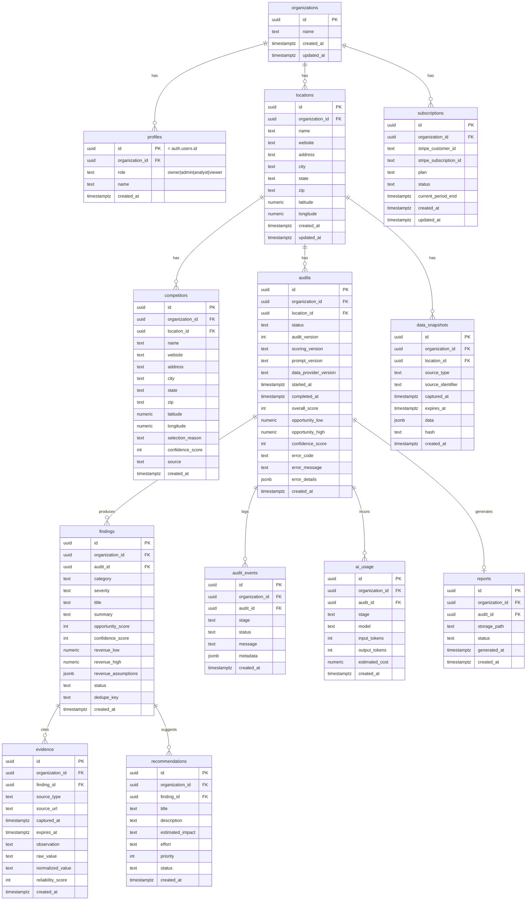

# 3. Database ERD / Schema

Postgres via Supabase. All business tables carry a denormalized `organization_id` (see
`04-rls-strategy.md` for why) even where it's reachable via a join, because RLS performance and
simplicity both benefit from not forcing every policy through a multi-table join.

## ERD



## DDL (annotated — final SQL lives in `supabase/migrations/`)

```sql
-- 001_initial_schema.sql

create table organizations (
  id uuid primary key default gen_random_uuid(),
  name text not null,
  created_at timestamptz not null default now(),
  updated_at timestamptz not null default now()
);

-- profiles.id intentionally equals auth.users.id (1:1), not a separate surrogate key
create table profiles (
  id uuid primary key references auth.users(id) on delete cascade,
  organization_id uuid not null references organizations(id) on delete restrict,
  role text not null check (role in ('owner','admin','analyst','viewer')),
  name text,
  created_at timestamptz not null default now()
);
create index on profiles (organization_id);

create table locations (
  id uuid primary key default gen_random_uuid(),
  organization_id uuid not null references organizations(id) on delete cascade,
  name text not null,
  website text not null,
  address text,
  city text,
  state text,
  zip text,
  latitude numeric(9,6),
  longitude numeric(9,6),
  created_at timestamptz not null default now(),
  updated_at timestamptz not null default now()
);
create index on locations (organization_id);

create table competitors (
  id uuid primary key default gen_random_uuid(),
  organization_id uuid not null references organizations(id) on delete cascade,
  location_id uuid not null references locations(id) on delete cascade,
  name text not null,
  website text,
  address text,
  city text,
  state text,
  zip text,
  latitude numeric(9,6),
  longitude numeric(9,6),
  selection_reason text not null,
  confidence_score int not null check (confidence_score between 0 and 100),
  source text not null,              -- 'google_places' | 'serp' | 'manual'
  -- idempotency: discovering the same place twice must not duplicate it
  place_id text,                     -- external provider's stable id, when available
  created_at timestamptz not null default now(),
  unique (location_id, place_id)
);
create index on competitors (organization_id);
create index on competitors (location_id);
```

```sql
-- 003_audit_pipeline.sql

create table audits (
  id uuid primary key default gen_random_uuid(),
  organization_id uuid not null references organizations(id) on delete cascade,
  location_id uuid not null references locations(id) on delete cascade,
  status text not null default 'queued' check (status in (
    'queued','collecting','normalizing','competitor_discovery',
    'analyzing','scoring','revenue_estimation','generating','completed','failed'
  )),
  -- versioning (brief §23) — frozen at audit creation, never mutated afterward
  audit_version int not null default 1,
  scoring_version text not null,
  prompt_version text not null,
  data_provider_version text not null,
  started_at timestamptz,
  completed_at timestamptz,
  overall_score int check (overall_score between 0 and 100),
  opportunity_low numeric(10,2),
  opportunity_high numeric(10,2),
  confidence_score int check (confidence_score between 0 and 100),
  error_code text,
  error_message text,                -- user-facing, brief §31
  error_details jsonb,                -- internal: stack/provider/stage, never shown to user
  retry_of_audit_id uuid references audits(id),
  created_at timestamptz not null default now()
);
create index on audits (organization_id);
create index on audits (location_id, created_at desc);

create table audit_events (
  id uuid primary key default gen_random_uuid(),
  organization_id uuid not null references organizations(id) on delete cascade,
  audit_id uuid not null references audits(id) on delete cascade,
  stage text not null,
  status text not null check (status in ('started','succeeded','failed','skipped')),
  message text,
  metadata jsonb,
  created_at timestamptz not null default now()
);
create index on audit_events (audit_id, created_at);
```

```sql
-- 004_evidence.sql

create table findings (
  id uuid primary key default gen_random_uuid(),
  organization_id uuid not null references organizations(id) on delete cascade,
  audit_id uuid not null references audits(id) on delete cascade,
  category text not null check (category in (
    'visibility','conversion','competitive','promotion','reputation','customer_experience'
  )),
  severity text not null check (severity in ('critical','high','medium','low')),
  title text not null,
  summary text not null,
  opportunity_score int not null check (opportunity_score between 0 and 100),
  confidence_score int not null check (confidence_score between 0 and 100),
  revenue_low numeric(10,2),
  revenue_high numeric(10,2),
  revenue_assumptions jsonb,          -- documented assumptions behind the range (brief §7)
  status text not null default 'new' check (status in ('new','accepted','dismissed','resolved')),
  -- idempotency on re-run: same audit + same underlying issue should update, not duplicate
  dedupe_key text not null,
  created_at timestamptz not null default now(),
  unique (audit_id, dedupe_key)
);
create index on findings (organization_id);
create index on findings (audit_id);

create table evidence (
  id uuid primary key default gen_random_uuid(),
  organization_id uuid not null references organizations(id) on delete cascade,
  finding_id uuid not null references findings(id) on delete cascade,
  source_type text not null check (source_type in (
    'website','search','review','competitor','business_profile','user_input'
  )),
  source_url text,
  captured_at timestamptz not null,
  expires_at timestamptz,             -- staleness feeds Confidence Score "Data Recency"
  observation text not null,
  raw_value text,
  normalized_value text,
  reliability_score int not null check (reliability_score between 0 and 100),
  created_at timestamptz not null default now()
);
create index on evidence (finding_id);

create table data_snapshots (
  id uuid primary key default gen_random_uuid(),
  organization_id uuid not null references organizations(id) on delete cascade,
  location_id uuid not null references locations(id) on delete cascade,
  source_type text not null,
  source_identifier text not null,    -- e.g. URL, place_id, competitor id
  captured_at timestamptz not null default now(),
  expires_at timestamptz,
  data jsonb not null,                -- raw provider payload
  hash text not null,                 -- sha256 of normalized payload, for idempotent re-collection
  created_at timestamptz not null default now(),
  unique (location_id, source_type, source_identifier, hash)
);
create index on data_snapshots (location_id, source_type);

create table recommendations (
  id uuid primary key default gen_random_uuid(),
  organization_id uuid not null references organizations(id) on delete cascade,
  finding_id uuid not null references findings(id) on delete cascade,
  title text not null,
  description text not null,
  estimated_impact text,
  effort text check (effort in ('low','medium','high')),
  priority int not null default 0,
  status text not null default 'pending' check (status in ('pending','in_progress','done','dismissed')),
  created_at timestamptz not null default now()
);
create index on recommendations (finding_id);

create table reports (
  id uuid primary key default gen_random_uuid(),
  organization_id uuid not null references organizations(id) on delete cascade,
  audit_id uuid not null references audits(id) on delete cascade,
  storage_path text,
  status text not null default 'pending' check (status in ('pending','generating','ready','failed')),
  generated_at timestamptz,
  created_at timestamptz not null default now(),
  unique (audit_id)
);
```

```sql
-- 006_ai_usage.sql

create table ai_usage (
  id uuid primary key default gen_random_uuid(),
  organization_id uuid not null references organizations(id) on delete cascade,
  audit_id uuid not null references audits(id) on delete cascade,
  stage text not null,                -- 'website_analyst' | 'competitive_analyst' | ...
  model text not null,
  input_tokens int not null,
  output_tokens int not null,
  estimated_cost numeric(10,4) not null,
  created_at timestamptz not null default now()
);
create index on ai_usage (audit_id);
create index on ai_usage (organization_id, created_at);
```

```sql
-- 007_billing.sql

create table subscriptions (
  id uuid primary key default gen_random_uuid(),
  organization_id uuid not null references organizations(id) on delete cascade,
  stripe_customer_id text not null,
  stripe_subscription_id text,
  plan text not null default 'free' check (plan in ('free','monitor','optimize','intelligence')),
  status text not null default 'active' check (status in (
    'active','trialing','past_due','canceled','incomplete'
  )),
  current_period_end timestamptz,
  created_at timestamptz not null default now(),
  updated_at timestamptz not null default now(),
  unique (organization_id)
);

-- idempotency for webhook processing (brief §29: never trust frontend payment state)
create table stripe_webhook_events (
  id text primary key,                -- Stripe event id, used to dedupe retried webhooks
  type text not null,
  processed_at timestamptz not null default now()
);
```

## Notes on deviations from the brief's §17 table list

- Added `organization_id` to every table below `locations` (denormalized) — RLS reasoning in
  `04-rls-strategy.md`.
- Added `expires_at` to `evidence` and `data_snapshots` — brief §10 lists `expiration_at` as
  part of the provenance model but it was missing from the concrete table definitions in §17.
- Added `dedupe_key` + unique constraint on `findings`, `place_id` + unique constraint on
  `competitors`, and `hash` + unique constraint on `data_snapshots` — these are what actually
  implement the idempotency requirement in brief §22 ("if competitor discovery runs twice, it
  should not create duplicate competitors"); the brief states the requirement but doesn't
  specify the mechanism.
- Added `reports` table (not in brief's table list, implied by §28) to track PDF generation
  status/storage path independently of the audit row, since report generation can be retried
  or regenerated without re-running the whole audit.
- Added `stripe_webhook_events` for webhook idempotency (brief §29 requires trusting only
  webhooks, but doesn't address Stripe's at-least-once delivery semantics).
- `error_details` (jsonb, internal-only) added alongside `error_message` (user-facing text) on
  `audits` to cleanly separate what brief §31 requires: a human-readable message to the user vs.
  full technical detail for logs/engineers.
- Did **not** create a separate `users` table — `profiles.id` references `auth.users(id)`
  directly per Supabase convention (brief §17 calls this table `users` but Supabase Auth owns
  the real `auth.users` table; a duplicate `users` table would just create a sync problem).
